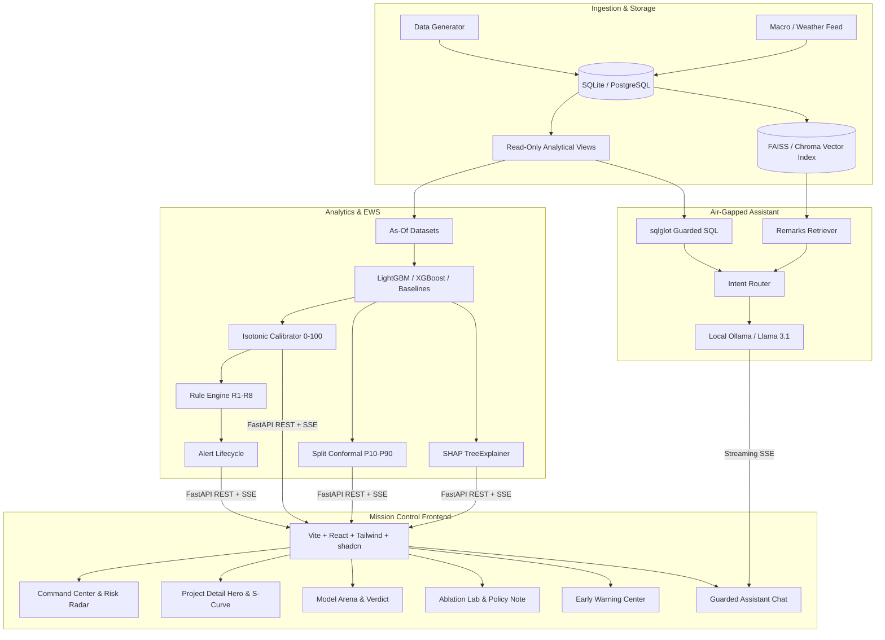

# DelayRay Architecture Specification

## 1. High-Level Architecture

## 2. Component Responsibilities
- **Data Layer:** Maintains temporal fidelity; monthly snapshots store as-of measurements. Read-only SQL views isolate analytical access.
- **ML Engine:** Implements group-aware, time-aware backtesting (splits: train <= 2016, val 2017-2018, test >= 2019). Produces calibrated 0-100 risk scores and P10-P90 conformal bounds.
- **Prescriptive & Early Warning:** Rule triggers evaluate SPI erosion, cost-progress divergence, and critical bottleneck tags. Lifecycle enforces state progression and cooldown windows.
- **Guarded Assistant:** Text-to-SQL parsing strictly filters queries through `sqlglot` against allowlisted views with forced `LIMIT 200`. Vector store extracts cited remarks.
- **Mission Control UI:** Modern dark-theme control room optimized for executive and analytical oversight.
